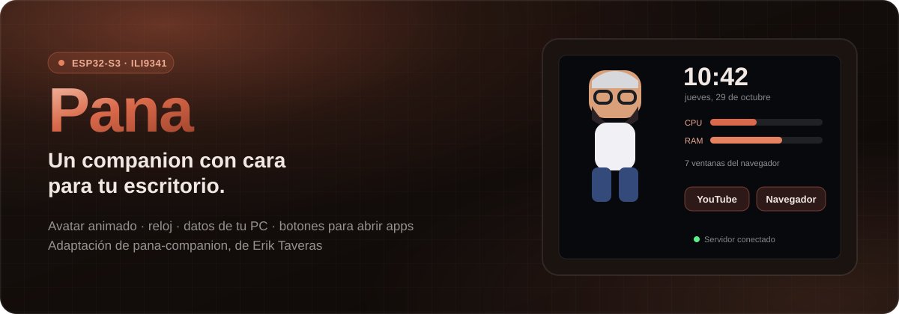
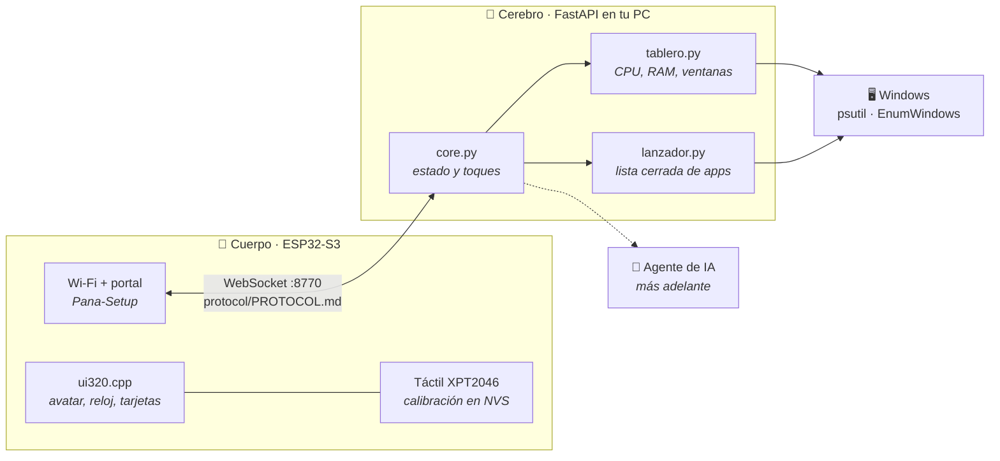
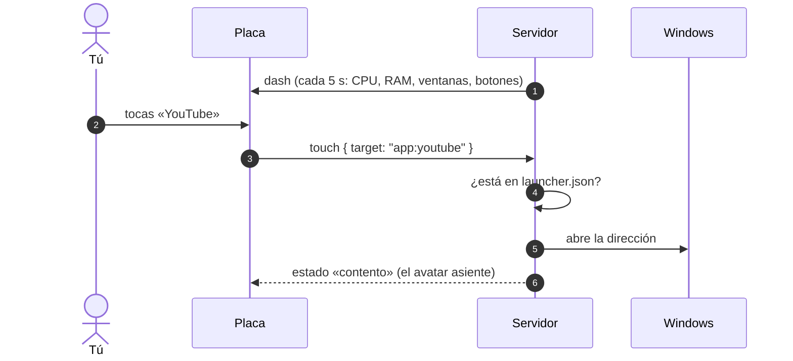

<div align="center">



<br/>

**Un avatar animado, la hora, los datos de tu PC y botones para abrir tus apps, en una placa de pocos dólares.**

ESP32-S3 N8R2 · pantalla táctil ILI9341 de 3,2" · servidor FastAPI en tu PC con Windows · en español

**adaptación de [pana-companion](https://github.com/eriktaveras/pana-companion), de Erik Taveras · por [iamnocodeveloper](https://github.com/iamnocodeveloper)**

<br/>

[](./LICENSE)
[](https://www.espressif.com/en/products/socs/esp32-s3)
[](https://platformio.org)
[](https://github.com/lovyan03/LovyanGFX)
[](https://fastapi.tiangolo.com)
[](./docs/instalacion-windows.md)

<br/>

[**Qué hace**](#-qué-hace-hoy) · [**Hardware**](#-hardware) · [**Arranque rápido**](#-arranque-rápido-en-windows) · [**Arquitectura**](#-arquitectura) · [**Documentación**](#-documentación) · [**Créditos**](#-créditos-y-licencia)

</div>

> **Este proyecto es una adaptación de [pana-companion](https://github.com/eriktaveras/pana-companion), de Erik Taveras** (licencia MIT). El diseño del sistema, el protocolo, el servidor, el avatar y el firmware original son suyos. Aquí se añade el soporte para otra placa y otra pantalla. Mira [Créditos](#-créditos-y-licencia) y [CAMBIOS.md](CAMBIOS.md).

---

## ⚡ Respuestas rápidas

| Pregunta | Respuesta |
|---|---|
| **¿Qué necesito?** | Un ESP32-S3 N8R2, un módulo ILI9341 de 3,2" de 16 bits con táctil, unos 30 cables Dupont y un PC con Windows. Sin soldar la pantalla: va por cables. |
| **¿Hace falta un agente de IA?** | No. Hoy funciona solo con el servidor de tu PC. Más adelante se le conecta un agente (Hermes Agent o un modelo local) y conversa. |
| **¿Tiene voz?** | Todavía no. La placa no trae micrófono ni altavoz; el plan está en [docs/audio.md](docs/audio.md). |
| **¿Qué puede abrir en mi PC?** | Solo lo que esté en la lista cerrada `server/launcher.json` (YouTube y el navegador de serie). Nada más. |
| **¿Dónde se guarda la Wi-Fi?** | En la placa, por un portal propio (`Pana-Setup`). No hay claves en el repositorio. |
| **¿Se puede usar otra pantalla?** | Sí, pero hay que añadir su bloque en `firmware/include/board.h`. Los pasos están en [docs/hardware.md](docs/hardware.md#añadir-una-placa). |

---

## 🎛 Qué hace hoy

Probado en el hardware de abajo:

| Función | Detalle |
|---|---|
| **Avatar animado** | 16 estados (listo, pensando, hablando, sin conexión…). Saluda al tocarle la cara. |
| **Reloj y fecha** | En tu zona horaria; el servidor manda la hora y la placa la mantiene. |
| **Datos de tu PC con Windows** | CPU, RAM, tiempo encendido y cuántas ventanas de navegador tienes abiertas. |
| **Botones para abrir apps** | YouTube y el navegador de serie; hasta 8 en `server/launcher.json` (4 en la página principal). |
| **Páginas que se deslizan** | Principal, **Apps**, **Mi PC** (CPU, RAM y gráfica), **Hoy** (agenda y redes) y **Hermes** (estado y última respuesta). Vuelve sola a la principal a los 60 s. |
| **Wi-Fi sin tocar código** | La placa abre la red `Pana-Setup`: pones tu Wi-Fi y la IP del servidor desde el móvil. |
| **Tarjetas y confirmaciones** | Botones, avisos y burbujas de texto, listos para cuando conectes un agente. |

**Qué falta:** la conversación con un agente, la voz (micrófono y altavoz) y montar la [caja de cartón](docs/caja.md), de la que hay un plano.

---

## 🔌 Hardware

| Pieza | Modelo |
|---|---|
| Placa | ESP32-S3 **N8R2** (flash de 8 MB, PSRAM de 2 MB), con dos USB-C |
| Pantalla | Módulo 3,2" **ILI9341**, 240×320, bus paralelo de **16 bits**, SKU MRB3205 |
| Táctil | Resistivo **XPT2046** por SPI (viene en el módulo) |
| Cables | Dupont hembra-hembra, unos 30 |

El cableado pin a pin está en [docs/cableado-ili9341.md](docs/cableado-ili9341.md). Quedan **6 pines libres** (14, 33, 34, 38, 43 y 44) para añadir una microSD, el micrófono y el amplificador, o un sensor de presencia.

---

## 🚀 Arranque rápido en Windows

Guía completa y con los tropiezos habituales: [docs/instalacion-windows.md](docs/instalacion-windows.md).

```powershell
git clone https://github.com/iamnocodeveloper/pana-s3-ili9341.git pana
cd pana
python -m venv .venv
.venv\Scripts\python -m pip install -r server\requirements.txt platformio pip-system-certs
copy .env.example .env             # y pon tu zona horaria en COMPANION_TZ
```

**Servidor** (el cerebro, en tu PC): doble clic a `iniciar-pana.bat`. Tu red de Windows debe ser **Privada** o el firewall bloquea a la placa.

**Firmware** (la placa):

```powershell
cd firmware
..\.venv\Scripts\pio run -e s3-ili9341 -t upload --upload-port COM4
```

La primera vez la pantalla te pide tocar cuatro cruces para calibrar el táctil. Luego conéctate desde el móvil a la red `Pana-Setup` y rellena tu Wi-Fi (de **2,4 GHz**), la IP del PC y el puerto `8770`.

> **Si la placa se queda en blanco o gris**, casi siempre está en modo descarga: desenchúfala y vuélvela a enchufar sin pulsar BOOT. Más casos en [solución de problemas](docs/solucion-de-problemas.md).

---

## 🏗 Arquitectura



La placa no decide nada: pinta lo que le manda el servidor y le devuelve los toques. El protocolo está en [protocol/PROTOCOL.md](protocol/PROTOCOL.md).

### Qué pasa al tocar un botón



---

## 🧩 Stack

| Capa | Elección | Por qué |
|---|---|---|
| Firmware | **Arduino-ESP32 2.0.17** con **PlatformIO** (`espressif32@6.9.0`) | La plataforma estándar; la de pioarduino da errores en Windows. |
| Pantalla | **LovyanGFX 1.2** | Bus paralelo de 16 bits por el periférico LCD_CAM del S3, con sprites en PSRAM. |
| Servidor | **FastAPI + WebSocket** | Es el original de Erik; aquí se le añade `psutil` para leer el PC. |
| Windows | **psutil** y **ctypes** | CPU, RAM y las ventanas del navegador, sin instalar nada más. |
| Avatar | **Pixel art con RLE** | 16 estados en unos 500 KB de flash. |

---

## 📚 Documentación

| Documento | Contenido |
|---|---|
| [`docs/instalacion-windows.md`](docs/instalacion-windows.md) | De cero a la placa funcionando, con los tropiezos habituales. |
| [`docs/cableado-ili9341.md`](docs/cableado-ili9341.md) | Cada cable, de qué color y a qué pin. |
| [`docs/solucion-de-problemas.md`](docs/solucion-de-problemas.md) | Pantalla en blanco, táctil, Wi-Fi, firewall. |
| [`docs/caja.md`](docs/caja.md) | El plano de la caja de cartón duro, a escala 1:1. |
| [`docs/audio.md`](docs/audio.md) | Micrófono y altavoz: qué comprar y a qué pines. |
| [`docs/avatar-propio.md`](docs/avatar-propio.md) | Cómo hacer tu propio avatar a partir de una imagen. |
| [`CAMBIOS.md`](CAMBIOS.md) | Lista de cambios sobre el original. |
| Del proyecto original | [README de Erik](README.erik.md) · [protocolo](protocol/PROTOCOL.md) · [hardware](docs/hardware.md) |

---

## 🗂 Estructura

```
firmware/                  el cuerpo (PlatformIO, LovyanGFX)
  src/ui/ui320.cpp           interfaz apaisada de 320×240 (nuevo)
  src/board_s3_ili9341.cpp   táctil y envío de imagen de esta pantalla (nuevo)
server/                    el cerebro (FastAPI)
  brain/lanzador.py          botones para abrir apps (nuevo)
  launcher.json              lista cerrada de lo que pueden abrir
caja/                      generador del plano de la caja en cartón (nuevo)
prueba-pantalla/           programa de prueba de pantalla y táctil (nuevo)
tools/avatar_imagen.py     genera los 16 estados desde una imagen (nuevo)
docs/                      documentación
iniciar-pana.bat           arranca el servidor en Windows (nuevo)
README.erik.md             el README original de Erik Taveras
```

---

## 🙏 Créditos y licencia

- **Proyecto original: [pana-companion](https://github.com/eriktaveras/pana-companion) de Erik Taveras.** Este repositorio conserva su historial de commits, su licencia y su documentación (`README.erik.md`).
- **Licencia MIT**, la misma que el original. El archivo [LICENSE](LICENSE) no se ha modificado.
- Dependencias de terceros en [THIRD_PARTY.md](THIRD_PARTY.md).
- Esta adaptación (la placa ESP32-S3 + ILI9341, la interfaz 320×240, el lanzador de apps, el soporte para Windows y la caja) la hizo [@iamnocodeveloper](https://github.com/iamnocodeveloper), con ayuda de Claude.

<div align="center">
<br/>

<br/><br/>
<sub><b>iamnocodeveloper</b></sub>
<br/>
<sub>Basado en <a href="https://github.com/eriktaveras/pana-companion">pana-companion</a>, de Erik Taveras</sub>
</div>
